<h1 align="center">
  
</h1>

  Estudante de Análise e Desenvolvimento de Sistemas · Jales, SP

  
  
  
  

## Projetos em destaque

| Projeto | O que faz |
| :---: | --- |
| <a href="https://github.com/samuel05015/ScanPlant"> <strong>ScanPlant</strong></a> | Aplicativo que identifica plantas por foto com IA e ajuda a organizar os cuidados com cada espécie. |
| <a href="https://genesissolarbr.com.br/"> <strong>Gênesis Solar</strong></a> | Site de energia solar e mobilidade elétrica, com simulador de economia e solicitação de orçamento. |
| <a href="https://calculadoraanalise.vercel.app/"> <strong>Calculadoraanalise</strong></a> | Calculadora de intervalos de confiança e tamanhos de amostra, com fórmulas explicadas passo a passo. |

<strong>Outros projetos</strong>

- **[Aurora Dental Studio](https://github.com/samuel05015/Aoba)** · Landing page demonstrativa para uma clínica odontológica fictícia, com layout responsivo e formulário de contato.
- **Catálogo de Cursos** · Aplicação web para reunir e consultar cursos em um só lugar.
- **Gestão de Alocação de Energia Solar** · Sistema para acompanhar a distribuição de créditos de energia solar.

## Sobre mim

Desenvolvo aplicações com foco no **front-end** e também tenho experiência com **back-end**. Gosto de criar interfaces fáceis de usar e trabalhar em equipe para transformar ideias em aplicações. Estou aberto a colaborações e oportunidades de estágio em desenvolvimento de software.

## Tecnologias

- **Interfaces** · HTML e CSS
- **Dados e serviços** · Supabase, Firebase, PostgreSQL e MySQL
- **Controle de versão** · Git
- **Em estudo** · C, C# e .NET

---

  <a href="https://github.com/samuel05015#js-contribution-activity">Atividade no GitHub</a> ·
  <a href="https://instagram.com/samu_henrique.cp">Instagram</a>

